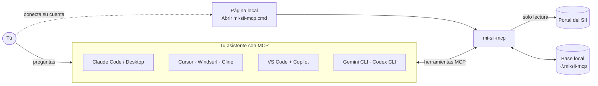

<p align="center">
  <picture>
    <source media="(prefers-color-scheme: dark)" srcset="docs/img/marca/logo-horizontal-oscuro.svg">
    
  </picture>
</p>

<h3 align="center">Tus impuestos del SII, conversados con tu asistente.</h3>

<p align="center">
  <a href="LICENSE"></a>
  
  <a href="https://modelcontextprotocol.io"></a>
  
  
</p>

<p align="center">
  Pregúntale a tu asistente por tus impuestos del SII, con tus datos reales.<br>
  <a href="#instalación">Instalación</a> ·
  <a href="#qué-lee-del-sii">Qué lee</a> ·
  <a href="#seguridad-y-privacidad">Seguridad</a> ·
  <a href="#herramientas-del-mcp">Herramientas</a> ·
  <a href="docs/guias/asistente-mcp.md">Guía completa</a>
</p>

mi-sii-mcp es un servidor [MCP](https://modelcontextprotocol.io) que conecta **cualquier asistente compatible con MCP** (Claude, Cursor, VS Code con Copilot, Gemini CLI, Codex, Windsurf, Cline y otros) con **tu cuenta del SII de Chile**. Trae tus datos tributarios, los guarda **solo en tu equipo** y los cruza para mostrarte qué cuadra, qué no y qué vence.

> [!WARNING]
> **No oficial.** No está afiliado al Servicio de Impuestos Internos ni es asesoría tributaria. Úsalo para revisar tu información; las decisiones tributarias son tuyas o de tu contador.

<p align="center">
  
</p>

---

## ¿Qué puedes preguntarle?

- «¿Cuánto me han retenido este año en boletas de honorarios?»
- «¿Cuadran mis boletas con lo que declaré en la renta?»
- «¿Qué informaron mis pagadores al SII sobre mí?»
- «¿Tengo algún F29 sin presentar o por vencer?»
- «¿Cuadra el IVA de mis compras y ventas con el F29 de septiembre?»
- «¿A quién le emití más boletas en 2026?»
- «Estímame la devolución de la próxima renta» (con fuentes oficiales para los valores públicos)

## Qué lee del SII

| Área | Qué trae | Qué cruza |
| --- | --- | --- |
| **IVA** | Registro de compras y ventas (RCV), F29 presentados (con su PDF) y propuesta de F29 | IVA del RCV contra el F29, F29 faltantes, facturas por reclamar, coherencia interna del F29 |
| **Boletas de honorarios** | Recibidas (por mes) y emitidas (resumen anual y detalle boleta por boleta) | Retención de las boletas contra el F29 (código 151) y contra la renta (códigos 547 y 492) |
| **Renta (F22)** | Declaraciones por año, folio vigente, códigos, observaciones y eventos (devoluciones, giros) | Boletas emitidas y lo informado por terceros contra el F22 |
| **Informado por terceros** | Declaraciones juradas que otros presentan sobre ti (p. ej. retenciones de honorarios, sueldos) | Retención informada por cada pagador contra tus boletas y tu F22; avisa si el SII observó la declaración de un informante |
| **Cuenta** | Perfil tributario (régimen, segmento, si declara el F29 hasta el día 20) y empresas autorizadas | Vencimientos del F29 según tu caso (día 12, 20 o 28) |

Los **datos públicos** (UTM, tablas de impuestos, tasas de cotización, comisiones de AFP) no se guardan: la herramienta `fuentes_oficiales` indica en qué página oficial consultarlos para el año que corresponda.

## Cómo funciona



1. **Conectas tu cuenta** una vez en una página local; la clave no pasa por el chat.
2. **El asistente pide datos** al MCP, que los lee del SII y los guarda en tu equipo.
3. **El MCP cruza la información** con reglas tributarias y responde con hallazgos claros.

## Seguridad y privacidad

- **Solo lee.** Nunca presenta, modifica ni emite nada en el SII.
- **Tus datos quedan en tu equipo**, en una base SQLite en `~/.mi-sii-mcp`. No hay servidores intermedios.
- **El asistente nunca ve tu clave.** El inicio de sesión lo haces tú en una página local o en el navegador; el MCP no tiene ninguna herramienta que reciba claves.
- Si eliges «Mantener conectada», la clave queda en el **almacén de credenciales del sistema** (Administrador de credenciales de Windows, Llavero de macOS o Secret Service en Linux), no en archivos.
- Los datos de terceros se limitan a lo necesario (p. ej. razón social del pagador); no se guardan correos, direcciones, códigos de barra ni el token de la sesión.
- Lo que el asistente consulta pasa a la conversación con él: pregunta solo por los contribuyentes que estés dispuesto a comentar ahí.

## Requisitos

- [Node.js](https://nodejs.org) 22.12 o superior (probado con Node 24).
- Cualquier cliente compatible con [MCP](https://modelcontextprotocol.io/clients) que ejecute servidores locales (stdio): Claude Code, Claude Desktop, Cursor, VS Code con Copilot, Gemini CLI, Codex CLI, Windsurf, Cline, entre otros.
- Clave tributaria del SII (o ClaveÚnica, desde el navegador).
- Windows es la plataforma probada; macOS y Linux deberían funcionar con el mismo código.

## Instalación

```bash
git clone https://github.com/Taksuma-0/mi-sii-mcp.git
cd mi-sii-mcp
npm install
npm run build
```

### 1. Registrar el servidor en tu asistente

El servidor se inicia con `node <carpeta>/dist/interfaces/cli/bin.js mcp`. Reemplaza `C:\ruta\a\mi-sii-mcp` por la carpeta donde clonaste el proyecto (en macOS/Linux, una ruta como `/home/tu-usuario/mi-sii-mcp`).

<details open>
<summary><b>Claude Code</b></summary>

```bash
claude mcp add --scope user mi-sii-mcp -- node "C:\ruta\a\mi-sii-mcp\dist\interfaces\cli\bin.js" mcp
```
</details>

<details>
<summary><b>Codex CLI</b> (<code>~/.codex/config.toml</code>)</summary>

```toml
[mcp_servers.mi-sii-mcp]
command = "node"
args = ["C:\\ruta\\a\\mi-sii-mcp\\dist\\interfaces\\cli\\bin.js", "mcp"]
```
</details>

<details>
<summary><b>VS Code con Copilot</b> (<code>.vscode/mcp.json</code> o la configuración de usuario)</summary>

```json
{
  "servers": {
    "mi-sii-mcp": {
      "type": "stdio",
      "command": "node",
      "args": ["C:\\ruta\\a\\mi-sii-mcp\\dist\\interfaces\\cli\\bin.js", "mcp"]
    }
  }
}
```
</details>

<details>
<summary><b>Claude Desktop, Cursor, Windsurf, Cline, Gemini CLI</b> y otros con formato <code>mcpServers</code></summary>

Agrega esto al archivo de configuración MCP de tu cliente (Claude Desktop: `claude_desktop_config.json`; Cursor: `~/.cursor/mcp.json`; Gemini CLI: `~/.gemini/settings.json`; Windsurf: `~/.codeium/windsurf/mcp_config.json`):

```json
{
  "mcpServers": {
    "mi-sii-mcp": {
      "command": "node",
      "args": ["C:\\ruta\\a\\mi-sii-mcp\\dist\\interfaces\\cli\\bin.js", "mcp"]
    }
  }
}
```
</details>

El servidor trae sus propias instrucciones de uso para el asistente (por dónde empezar, cómo reintentar, que nunca pida la clave), así que funciona igual con cualquier cliente.

### 2. Conectar tu cuenta del SII

En Windows, haz doble clic en **`Abrir mi-sii-mcp.cmd`** (en la carpeta del proyecto). Se abre una página local donde:

1. Escribes tu RUT (los puntos y el guion se ponen solos) y tu clave tributaria.
2. Dejas marcado **Mantener conectada** para que la sesión se renueve sola.
3. Pulsas **Conectar**.

<p align="center">
  
</p>

Puedes conectar varias cuentas (tu RUT personal y tus empresas). También puedes entrar con **ClaveÚnica** desde la misma página, aunque esa sesión no se renueva sola.

En otras plataformas, abre la página con `npm run local`, o inicia sesión desde la terminal con `node dist/interfaces/cli/bin.js login <rut> --guardar-clave`.

### 3. Preguntar

Reinicia tu asistente (en Claude Code basta con `/mcp`) para que cargue el servidor y pregunta, por ejemplo: «lista mis perfiles» o «trae mi renta de los últimos 3 años».

## Herramientas del MCP

| Herramienta | Para qué sirve | ¿Consulta al SII? |
| --- | --- | --- |
| `perfiles_listar` | Cuentas configuradas, estado de su sesión y si se renueva sola | No |
| `sii_panorama` | Qué hay guardado por mes y por año | No |
| `sincronizar` | Trae RCV y F29 de un rango de meses (opcional: propuesta de F29 y boletas recibidas) | Sí (lectura) |
| `renta_sincronizar` | Trae el F22, las boletas emitidas y lo informado por terceros, por año tributario | Sí (lectura) |
| `perfil_sincronizar` | Trae el perfil tributario y las empresas autorizadas | Sí (lectura) |
| `iva_resumen`, `iva_hallazgos` | Conciliación del IVA y hallazgos por mes | No |
| `f29_historial`, `plazos_proximos` | Historial de F29 y vencimientos | No |
| `rcv_documentos` | Documentos del RCV de un mes | No |
| `renta_resumen` | Renta guardada con sus cruces (boletas, pagadores, terceros) | No |
| `f29_releer` | Vuelve a leer los PDF de F29 guardados, sin ir al SII | No |
| `fuentes_oficiales` | Dónde consultar los datos públicos (UTM, tablas, tasas) y cómo estimar una renta | No |
| `datos_esquema`, `consulta_sql` | Mapa de las tablas y consultas `SELECT` de solo lectura para preguntas libres | No |

## Uso desde la terminal (opcional)

Todo lo anterior también está disponible como comandos:

```bash
node dist/interfaces/cli/bin.js --help
node dist/interfaces/cli/bin.js perfil listar
node dist/interfaces/cli/bin.js sync <rut> --desde 2026-01 --hasta 2026-09
node dist/interfaces/cli/bin.js renta sync <rut> --desde 2025 --hasta 2027
node dist/interfaces/cli/bin.js renta ver <rut>
```

## Configuración

Variables de entorno opcionales:

| Variable | Para qué |
| --- | --- |
| `MI_SII_MCP_HOME` | Carpeta de datos (por defecto `~/.mi-sii-mcp`) |
| `MI_SII_MCP_PLAZO_HTTP_MS` | Plazo de cada consulta al SII (por defecto 60 s) |
| `MI_SII_MCP_INTERVALO_MS` | Pausa mínima entre consultas al SII (por defecto 1 s) |
| `MI_SII_MCP_TOLERANCIA` | Tolerancia en pesos para los cruces de IVA |
| `MI_SII_MCP_NAVEGADOR` | Ruta de Edge o Chrome para entrar con ClaveÚnica |
| `MI_SII_MCP_PLAZO_NAVEGADOR_MS` | Tiempo para completar el inicio de sesión en el navegador |

## Desarrollo

```bash
npm test            # pruebas (solo datos ficticios; nunca consultan el SII real)
npm run typecheck   # tipos
npm run build       # compila a dist/
npm run probar:mcp  # prueba el servidor MCP compilado
```

El código está organizado por capas (`domain`, `app`, `connectors`, `store`, `interfaces`, `main`); `test/arquitectura.test.ts` verifica que se respeten. Las decisiones de diseño están en [`docs/decisiones`](docs/decisiones) y las guías de uso en [`docs/guias`](docs/guias).

Las contribuciones son bienvenidas. Por favor, **nunca incluyas datos tributarios reales** (RUT, nombres, montos) en issues, pruebas ni fixtures: usa RUT ficticios como `11.111.111-1`.

## Limitaciones

- La propuesta del F22 aún no se lee (el SII la publica en abril).
- La declaración de sueldos del empleador (DJ 1887) se lee de forma genérica: su formato no se ha verificado con datos reales.
- Si el SII cambia su portal, algunas lecturas pueden fallar hasta actualizar el lector; los errores lo indican y nunca se borran datos guardados por una respuesta vacía.

## Licencia

[MIT](LICENSE) © 2026 Welinton Barrera
