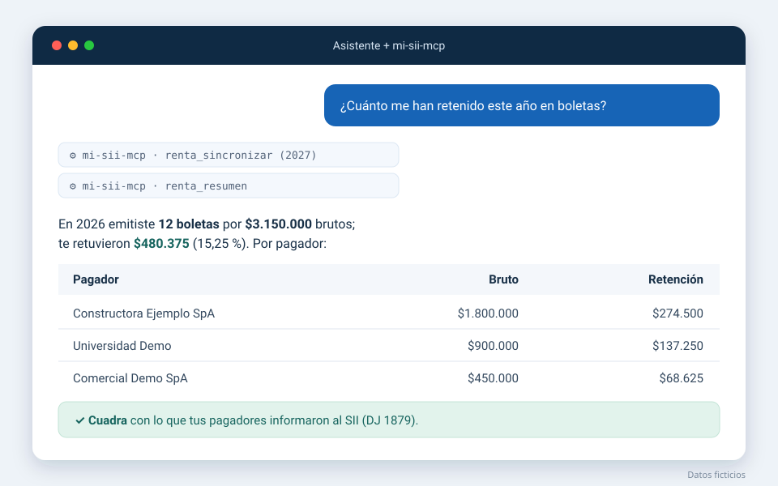
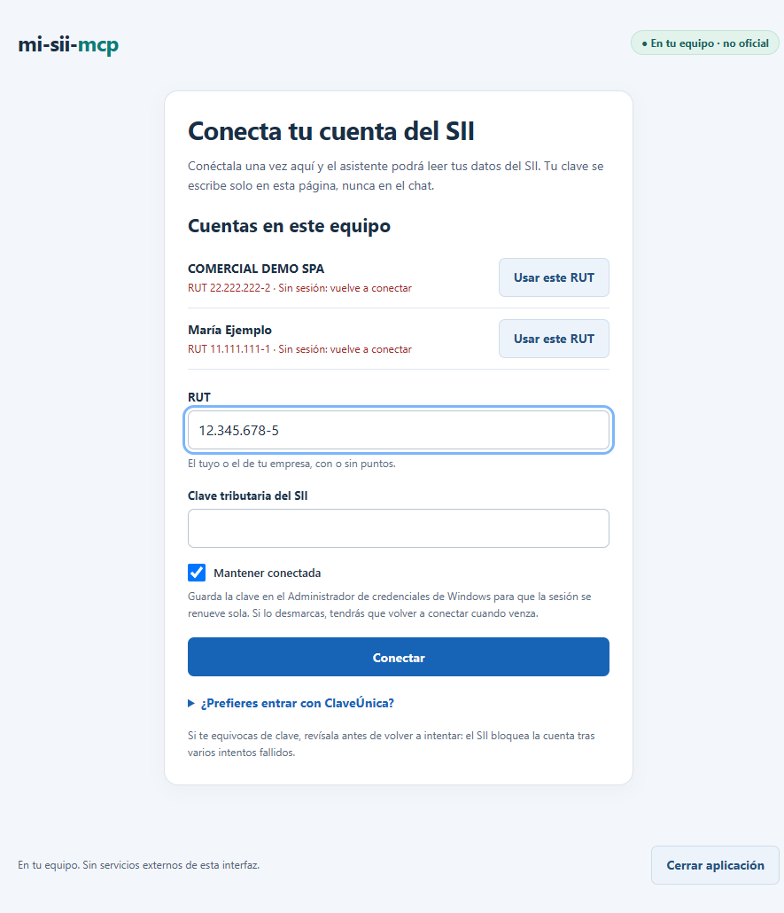

<p align="center">
  <picture>
    <source media="(prefers-color-scheme: dark)" srcset="docs/img/marca/logo-horizontal-oscuro.svg">
    
  </picture>
</p>

<h1 align="center">mi-sii-mcp — Servidor MCP para el SII de Chile</h1>

<p align="center"><b>Tus impuestos del SII, conversados con tu asistente de IA.</b></p>

<p align="center">
  <a href="LICENSE"></a>
  
  
  <a href="https://modelcontextprotocol.io"></a>
  
</p>

<p align="center">
  <a href="https://glama.ai/mcp/servers/Taksuma-0/mi-sii-mcp"></a>
  <a href="https://mcpservers.org/servers/taksuma-0/mi-sii-mcp"></a>
</p>

<p align="center">
  <a href="https://taksuma-0.github.io/mi-sii-mcp/">Sitio web</a> ·
  <a href="#instalación">Instalación</a> ·
  <a href="#compatibilidad-con-agentes-de-ia">Compatibilidad</a> ·
  <a href="#ejemplos-de-consultas-tributarias">Ejemplos</a> ·
  <a href="#preguntas-frecuentes">Preguntas frecuentes</a> ·
  <a href="docs/guias/asistente-mcp.md">Guía completa</a>
</p>

**mi-sii-mcp** es un servidor [Model Context Protocol (MCP)](https://modelcontextprotocol.io) de código abierto que conecta asistentes de inteligencia artificial —**Claude, Codex, Cursor, Gemini CLI, VS Code con Copilot** y otros clientes MCP— con tu información tributaria del **Servicio de Impuestos Internos (SII) de Chile**. Lee tu IVA, tus F29, tu renta (F22), tus boletas de honorarios y lo que otros informan sobre ti; lo guarda **en tu equipo** y lo **concilia** para mostrarte qué cuadra, qué no y qué vence. Funciona en **solo lectura** y el asistente nunca recibe tu clave.

> [!NOTE]
> Proyecto independiente de código abierto: no está afiliado al SII ni reemplaza la asesoría de un contador. Úsalo para revisar tu información y tomar mejores decisiones.

<p align="center">
  
</p>

---

## Características principales

- **Consultas tributarias en lenguaje natural**: pregúntale a tu asistente por tu IVA, tus F29, tu renta o tus boletas de honorarios, con tus datos reales del SII.
- **Conciliación automática**: cruza el registro de compras y ventas con el F29, las boletas con la renta y lo que informan tus pagadores con tus propios registros.
- **Alertas útiles**: F29 sin presentar o por vencer (día 12, 20 o 28 según tu caso), facturas por reclamar y descuadres.
- **Solo lectura**: nunca presenta, modifica ni emite nada en el SII.
- **Datos locales**: todo se guarda en una base SQLite en tu equipo; no hay servidores intermedios.
- **La clave no pasa por el chat**: inicias sesión en una página local y ninguna herramienta del MCP recibe claves.
- **Varias cuentas**: tu RUT personal y los de tus empresas, cada uno con su propia sesión.
- **Open source (MIT)**, escrito en TypeScript, con más de 1.300 pruebas automáticas que usan solo datos ficticios.

## Qué lee del SII y qué concilia

| Área | Qué trae del SII | Qué concilia |
| --- | --- | --- |
| **IVA** | Registro de Compras y Ventas (RCV), F29 presentados (con su PDF) y propuesta de F29 | IVA del RCV contra el F29, F29 faltantes, facturas por reclamar y coherencia interna del F29 |
| **Boletas de honorarios** | Recibidas (por mes) y emitidas (resumen anual y detalle boleta por boleta) | Retención de las boletas contra el F29 (código 151) y contra la renta (códigos 547 y 492) |
| **Renta (F22)** | Declaraciones por año tributario, folio vigente, códigos, observaciones y eventos (devoluciones, giros) | Boletas emitidas y lo informado por terceros contra el F22 |
| **Informado por terceros** | Declaraciones juradas que otros presentan sobre ti (p. ej. retenciones de honorarios) | Lo que informa cada pagador contra tus boletas y tu F22; avisa si el SII observó la declaración de un informante |
| **Cuenta** | Perfil tributario (régimen, segmento, autorización para declarar el F29 hasta el día 20) y empresas autorizadas | Vencimientos del F29 según tu caso |

Los **datos públicos** (UTM, tablas de impuestos, tasas de cotización, comisiones de AFP) no se guardan: la herramienta `fuentes_oficiales` indica en qué página oficial consultarlos para el año que corresponda.

## Qué no hace

mi-sii-mcp (repositorio oficial: [github.com/Taksuma-0/mi-sii-mcp](https://github.com/Taksuma-0/mi-sii-mcp)) sirve para **consultar y conciliar** tu información tributaria. Para no confundirlo con otros proyectos de nombre parecido:

- **No emite** facturas, boletas ni otros documentos, y **no usa el Sistema de Facturación Gratuito** del SII (MiPyme).
- **No presenta ni rectifica** declaraciones (F29, F22) ni modifica nada en el portal.
- **No descarga los archivos XML o PDF de las facturas electrónicas (DTE)**: lee el detalle del Registro de Compras y Ventas.
- **No opera el portal con un navegador automatizado**: consulta el SII directamente y solo abre el navegador, si tú lo eliges, para iniciar sesión con ClaveÚnica.
- **No envía tus datos a servidores de terceros**: todo queda en tu equipo.

## Compatibilidad con agentes de IA

mi-sii-mcp es un servidor MCP local (transporte **stdio**), así que funciona con los clientes que ejecutan servidores MCP locales.

| Cliente | Estado | Cómo se configura |
| --- | --- | --- |
| **Claude Code** | ✅ Probado | `claude mcp add` ([ver instalación](#1-registrar-el-servidor-en-tu-asistente)) |
| **Claude Desktop** | Configuración documentada | `claude_desktop_config.json` (formato `mcpServers`) |
| **Codex CLI** | Configuración documentada | `~/.codex/config.toml` |
| **Cursor** | Configuración documentada | `~/.cursor/mcp.json` (formato `mcpServers`) |
| **VS Code con GitHub Copilot** | Configuración documentada | `.vscode/mcp.json` |
| **Gemini CLI** | Configuración documentada | `~/.gemini/settings.json` (formato `mcpServers`) |
| **Windsurf, Cline** y otros | Configuración documentada | Formato `mcpServers` |

«Configuración documentada» significa que se usa el formato MCP estándar de cada cliente; el desarrollo y las pruebas en vivo se hicieron con Claude Code.

## Cómo funciona


1. **Conectas tu cuenta** una vez en una página local; la clave no pasa por el chat.
2. **El asistente pide datos** al servidor MCP, que los lee del SII y los guarda en tu equipo.
3. **mi-sii-mcp concilia la información** con reglas tributarias y responde con hallazgos claros.

## Requisitos

- [Node.js](https://nodejs.org) 22.12 o superior (probado con Node 24).
- Un cliente MCP que ejecute servidores locales (ver [compatibilidad](#compatibilidad-con-agentes-de-ia)).
- Clave tributaria del SII.
- Windows es la plataforma probada; el código es multiplataforma y en macOS o Linux la página local se abre con `npm run local`.

## Instalación

```bash
git clone https://github.com/Taksuma-0/mi-sii-mcp.git
cd mi-sii-mcp
npm install
npm run build
```

### 1. Registrar el servidor en tu asistente

El servidor se inicia con `node <carpeta>/dist/interfaces/cli/bin.js mcp`. Reemplaza `C:\ruta\a\mi-sii-mcp` por la carpeta donde clonaste el proyecto (en macOS/Linux, una ruta como `/home/tu-usuario/mi-sii-mcp`).

<details open>
<summary><b>Claude Code</b></summary>

```bash
claude mcp add --scope user mi-sii-mcp -- node "C:\ruta\a\mi-sii-mcp\dist\interfaces\cli\bin.js" mcp
```
</details>

<details>
<summary><b>Codex CLI</b> (<code>~/.codex/config.toml</code>)</summary>

```toml
[mcp_servers.mi-sii-mcp]
command = "node"
args = ["C:\\ruta\\a\\mi-sii-mcp\\dist\\interfaces\\cli\\bin.js", "mcp"]
```
</details>

<details>
<summary><b>VS Code con Copilot</b> (<code>.vscode/mcp.json</code> o la configuración de usuario)</summary>

```json
{
  "servers": {
    "mi-sii-mcp": {
      "type": "stdio",
      "command": "node",
      "args": ["C:\\ruta\\a\\mi-sii-mcp\\dist\\interfaces\\cli\\bin.js", "mcp"]
    }
  }
}
```
</details>

<details>
<summary><b>Claude Desktop, Cursor, Windsurf, Cline, Gemini CLI</b> y otros con formato <code>mcpServers</code></summary>

Agrega esto al archivo de configuración MCP de tu cliente (Claude Desktop: `claude_desktop_config.json`; Cursor: `~/.cursor/mcp.json`; Gemini CLI: `~/.gemini/settings.json`; Windsurf: `~/.codeium/windsurf/mcp_config.json`):

```json
{
  "mcpServers": {
    "mi-sii-mcp": {
      "command": "node",
      "args": ["C:\\ruta\\a\\mi-sii-mcp\\dist\\interfaces\\cli\\bin.js", "mcp"]
    }
  }
}
```
</details>

El servidor trae sus propias instrucciones de uso para el asistente (por dónde empezar, cómo reintentar, que nunca pida la clave), así que se comporta igual con cualquier cliente.

### 2. Conectar tu cuenta del SII

En Windows, haz doble clic en **`Abrir mi-sii-mcp.cmd`** (en la carpeta del proyecto). Se abre una página local donde:

1. Escribes tu RUT (los puntos y el guion se ponen solos) y tu clave tributaria.
2. Dejas marcado **Mantener conectada** para que la sesión se renueve sola.
3. Pulsas **Conectar**.

<p align="center">
  
</p>

Puedes conectar varias cuentas (tu RUT personal y tus empresas). La misma página ofrece entrar con **ClaveÚnica** desde el navegador; esa opción es **experimental** (aún no se ha probado con una cuenta real) y su sesión no se renueva sola.

En otras plataformas, abre la página con `npm run local`, o inicia sesión desde la terminal con `node dist/interfaces/cli/bin.js login <rut> --guardar-clave`.

### 3. Preguntar

Reinicia tu asistente (en Claude Code basta con `/mcp`) para que cargue el servidor y pregunta, por ejemplo: «lista mis perfiles» o «trae mi renta de los últimos 3 años».

## Ejemplos de consultas tributarias

| Pregunta al asistente | Qué hace mi-sii-mcp |
| --- | --- |
| «¿Cuánto me han retenido este año en boletas de honorarios?» | Trae tus boletas emitidas y suma la retención por mes y por pagador (`renta_sincronizar`, `renta_resumen`) |
| «¿Cuadran mis boletas con lo que declaré en la renta?» | Compara tus boletas con los códigos 547 y 492 del F22, considerando el reajuste por IPC |
| «¿Qué informaron mis pagadores al SII sobre mí?» | Lee las declaraciones juradas de terceros y las cruza con tus boletas |
| «¿Tengo algún F29 sin presentar o por vencer?» | Revisa tus F29 y calcula el vencimiento según tu caso (`plazos_proximos`, `iva_hallazgos`) |
| «¿Cuadra el IVA de compras y ventas con el F29 de septiembre?» | Concilia el RCV con el F29 del mes (`iva_resumen`) |
| «¿A quién le emití más boletas en 2026?» | Consulta el detalle boleta por boleta guardado (`consulta_sql`) |
| «Estímame la devolución de la próxima renta» | Junta tus datos y te indica las fuentes oficiales de los valores públicos (`fuentes_oficiales`) |

## Skill para agentes

El repositorio incluye una skill en el formato estándar **Agent Skills** (`SKILL.md`): [`skills/mi-sii-mcp`](skills/mi-sii-mcp/SKILL.md). Le enseña a tu agente cuándo usar mi-sii-mcp, qué herramienta usar para cada tarea (revisión de IVA, boletas, renta, vencimientos, preguntas libres), las reglas de seguridad y cómo **repartir el trabajo entre varios agentes**: un solo agente consulta el SII y el resto analiza los datos guardados en paralelo.

- **Claude Code:** copia la carpeta `skills/mi-sii-mcp` a `~/.claude/skills/` (para todos tus proyectos) o a `.claude/skills/` dentro de un proyecto.
- **Otros agentes compatibles con `SKILL.md`:** copia la misma carpeta en su directorio de skills.

La skill complementa al servidor, que además entrega sus propias instrucciones a cualquier cliente MCP.

## Herramientas del MCP

| Herramienta | Para qué sirve | ¿Consulta al SII? |
| --- | --- | --- |
| `perfiles_listar` | Cuentas configuradas, estado de su sesión y si se renueva sola | No |
| `sii_panorama` | Qué hay guardado por mes y por año | No |
| `sincronizar` | Trae RCV y F29 de un rango de meses (opcional: propuesta de F29 y boletas recibidas) | Sí (lectura) |
| `renta_sincronizar` | Trae el F22, las boletas emitidas y lo informado por terceros, por año tributario | Sí (lectura) |
| `perfil_sincronizar` | Trae el perfil tributario y las empresas autorizadas | Sí (lectura) |
| `iva_resumen`, `iva_hallazgos` | Conciliación del IVA y hallazgos por mes | No |
| `f29_historial`, `plazos_proximos` | Historial de F29 y vencimientos | No |
| `rcv_documentos` | Documentos del RCV de un mes | No |
| `renta_resumen` | Renta guardada con sus cruces (boletas, pagadores, terceros) | No |
| `f29_releer` | Vuelve a leer los PDF de F29 guardados, sin ir al SII | No |
| `fuentes_oficiales` | Dónde consultar los datos públicos (UTM, tablas, tasas) y cómo estimar una renta | No |
| `datos_esquema`, `consulta_sql` | Mapa de las tablas y consultas `SELECT` de solo lectura para preguntas libres | No |

## Seguridad y privacidad

- **Solo lee.** Nunca presenta, modifica ni emite nada en el SII.
- **Tus datos quedan en tu equipo**, en una base SQLite en `~/.mi-sii-mcp`; el servidor se comunica directamente con el SII, sin servidores intermedios.
- **El asistente nunca recibe tu clave.** El inicio de sesión lo haces tú en una página local o en la terminal; el MCP no tiene ninguna herramienta que reciba claves.
- **La sesión** se guarda como cookies en tu equipo para no pedirte la clave en cada consulta. Si eliges «Mantener conectada», la clave queda en el **almacén de credenciales del sistema** (Administrador de credenciales de Windows, Llavero de macOS o Secret Service en Linux), no en archivos.
- **Las respuestas del SII que se guardan como respaldo se sanean**: sin correos, direcciones, códigos de barra ni el token de la sesión. De terceros se guarda solo lo necesario (p. ej. la razón social de un pagador).
- **Lo que consultas pasa a la conversación** con tu asistente (y a su proveedor de IA): pregunta solo por los contribuyentes que estés dispuesto a comentar ahí.

## Preguntas frecuentes

### ¿Qué es mi-sii-mcp?
Es un servidor MCP de código abierto que permite que un asistente de IA consulte y concilie tu información tributaria del SII de Chile: IVA, F29, renta F22, boletas de honorarios y declaraciones de terceros.

### ¿Qué es un servidor MCP y por qué usarlo con el SII?
MCP (Model Context Protocol) es un estándar abierto para que los asistentes de IA usen herramientas externas. Un servidor MCP para el SII le da a tu asistente herramientas para leer tus datos tributarios y aplicar reglas de conciliación, en vez de que copies y pegues información del portal.

### ¿Cómo conecto Claude, Codex, Cursor o Gemini CLI al SII?
Instala mi-sii-mcp, regístralo en tu cliente con la [configuración de la instalación](#1-registrar-el-servidor-en-tu-asistente) y conecta tu cuenta en la página local. Claude Code está probado; para los demás clientes se usa su formato MCP estándar.

### ¿El asistente puede ver mi clave tributaria?
No. La clave se escribe solo en la página local (o en la terminal) y ninguna herramienta del MCP la recibe. Si eliges mantener la sesión, la clave queda en el almacén de credenciales de tu sistema.

### ¿Dónde quedan mis datos?
En tu equipo, en `~/.mi-sii-mcp`. Lo que preguntas y las respuestas sí pasan por tu asistente de IA, como cualquier conversación con él.

### ¿Puede presentar mi F29 o emitir boletas?
No. mi-sii-mcp solo lee el portal del SII; no presenta declaraciones, no emite documentos ni modifica nada.

### ¿mi-sii-mcp emite facturas o usa el Sistema de Facturación Gratuito del SII?
No. mi-sii-mcp no emite facturas ni boletas, no usa el Sistema de Facturación Gratuito del SII y no descarga los archivos de las facturas electrónicas (DTE). Lee el Registro de Compras y Ventas, los F29, la renta F22, las boletas de honorarios y las declaraciones de terceros, siempre en solo lectura. Su código está en github.com/Taksuma-0/mi-sii-mcp.

### ¿Es una herramienta oficial del SII?
No. Es un proyecto independiente de código abierto y no reemplaza la asesoría de un contador.

### ¿Cuánto cuesta?
Es gratuito y de código abierto (licencia MIT). Solo necesitas un cliente MCP; el costo del asistente de IA depende de su proveedor.

### ¿Funciona en macOS o Linux?
El código es multiplataforma, pero la plataforma probada es Windows. En macOS o Linux la página para conectar la cuenta se abre con `npm run local`.

## Uso desde la terminal (opcional)

Todo lo anterior también está disponible como comandos:

```bash
node dist/interfaces/cli/bin.js --help
node dist/interfaces/cli/bin.js perfil listar
node dist/interfaces/cli/bin.js sync <rut> --desde 2026-01 --hasta 2026-09
node dist/interfaces/cli/bin.js renta sync <rut> --desde 2025 --hasta 2027
node dist/interfaces/cli/bin.js renta ver <rut>
```

## Configuración

Variables de entorno opcionales:

| Variable | Para qué |
| --- | --- |
| `MI_SII_MCP_HOME` | Carpeta de datos (por defecto `~/.mi-sii-mcp`) |
| `MI_SII_MCP_PLAZO_HTTP_MS` | Plazo de cada consulta al SII (por defecto 60 s) |
| `MI_SII_MCP_INTERVALO_MS` | Pausa mínima entre consultas al SII (por defecto 1 s) |
| `MI_SII_MCP_TOLERANCIA` | Tolerancia en pesos para los cruces de IVA |
| `MI_SII_MCP_NAVEGADOR` | Ruta de Edge o Chrome para entrar con ClaveÚnica |
| `MI_SII_MCP_PLAZO_NAVEGADOR_MS` | Tiempo para completar el inicio de sesión en el navegador |

## Documentación

- [Sitio web del proyecto](https://taksuma-0.github.io/mi-sii-mcp/)
- [Guía para usarlo con un asistente](docs/guias/asistente-mcp.md): instalación detallada, preguntas, herramientas y solución de problemas.
- [Guía de la página local](docs/guias/interfaz-local.md)
- [Decisiones de diseño](docs/decisiones): plazos del F29, áreas del SII, datos públicos de la renta y más.
- [Difusión y directorios MCP](docs/difusion.md): metadatos para directorios y registro en buscadores.

## Desarrollo

```bash
npm test            # pruebas (solo datos ficticios; nunca consultan el SII real)
npm run typecheck   # tipos
npm run build       # compila a dist/
npm run probar:mcp  # prueba el servidor MCP compilado
```

El código está organizado por capas (`domain`, `app`, `connectors`, `store`, `interfaces`, `main`); `test/arquitectura.test.ts` verifica que se respeten.

Las contribuciones son bienvenidas. Por favor, **nunca incluyas datos tributarios reales** (RUT, nombres, montos) en issues, pruebas ni fixtures: usa RUT ficticios como `11.111.111-1`.

## Limitaciones

- La propuesta del F22 aún no se lee (el SII la publica en abril).
- La declaración de sueldos del empleador (DJ 1887) se lee de forma genérica: su formato no se ha verificado con datos reales.
- El inicio de sesión con ClaveÚnica desde el navegador es experimental.
- Si el SII cambia su portal, algunas lecturas pueden fallar hasta actualizar el lector; los errores lo indican y nunca se borran datos guardados por una respuesta vacía.

## Licencia

[MIT](LICENSE) © 2026 Welinton Barrera · Código fuente: [github.com/Taksuma-0/mi-sii-mcp](https://github.com/Taksuma-0/mi-sii-mcp)
